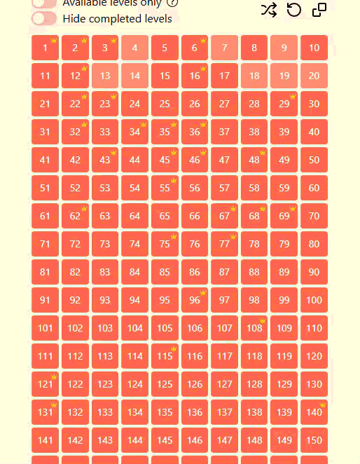
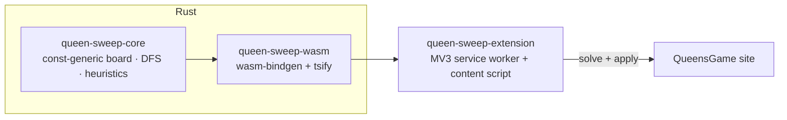

# ♛ QueenSweep

**QueenSweep** is a high-performance solver for the [Queens puzzle](https://www.linkedin.com/showcase/queens-game) — a Rust depth-first-search engine, compiled to WebAssembly, and delivered through a Manifest V3 Chromium extension that solves puzzles directly in the browser.

> [!NOTE]
> LinkedIn prohibits automated interaction with its platform, so the Chromium extension targets the open-source [QueensGame](https://queensgame.vercel.app) site instead.

## 📋 Table of Contents

1. [Features](#-features)
2. [Demo](#-demo)
3. [Architecture](#️-architecture)
4. [Project Structure](#-project-structure)
5. [Running Locally](#-running-locally)
6. [Releases](#-releases)

## 📃 Features

- **🚀 Blazingly fast** — solves most boards in a few milliseconds via depth-first search with aggressive constraint propagation.
- **📐 Const-generic core** — the board is sized at compile time (`N`), with a runtime `dynamic` layer that dispatches `Vec`-based input to the appropriate monomorphization.
- **🧠 Heuristic-driven search** — pluggable move-ordering heuristics (`NoOp`, `SmallestRegionFirst`) that prune the search space.
- **🌐 WebAssembly runtime** — `wasm-bindgen` + `tsify` produce fully typed `.d.ts` declarations for seamless TypeScript use.
- **🛰️ Integrated browser extension** — detects QueensGame puzzles, extracts the board, and applies the solution with one click.

## 👾 Demo



## 🏗️ Architecture



## 📂 Project Structure

```sh
queen-sweep/
├── crates/
│   ├── queen-sweep-core/      # Core Rust engine (+ runtime `dynamic` API)
│   └── queen-sweep-wasm/      # Type-safe WebAssembly bindings
└── queen-sweep-extension/     # Manifest V3 Chromium extension
```

Each subproject has its own README with full documentation:

- [Core engine](./crates/queen-sweep-core/README.md)
- [WebAssembly bindings](./crates/queen-sweep-wasm/README.md)
- [Browser extension](./queen-sweep-extension/README.md)

## 💻 Running Locally

Prerequisites: [Rust](https://rustup.rs/), [Node.js](https://nodejs.org), and [wasm-pack](https://github.com/drager/wasm-pack). The repo also ships a Nix devshell that provides all of them (plus the `wasm32-unknown-unknown` target and `binaryen`):

```bash
nix develop
cargo test --workspace
```

### Core engine

```bash
cargo test -p queen-sweep-core
```

### WebAssembly bindings

```bash
cd crates/queen-sweep-wasm
wasm-pack build --target web
```

### Browser extension

```bash
cd queen-sweep-extension
npm install
npm run build
```

Then open `chrome://extensions/` (or `brave://extensions/`), enable **Developer mode**, click **Load unpacked**, and select `queen-sweep-extension/dist`.

## 📦 Releases

Download the latest `queen-sweep-extension-v*.zip` from the [Releases](https://github.com/lalitm1004/queen-sweep/releases) page, unzip it, and load the extracted folder as an unpacked extension.
